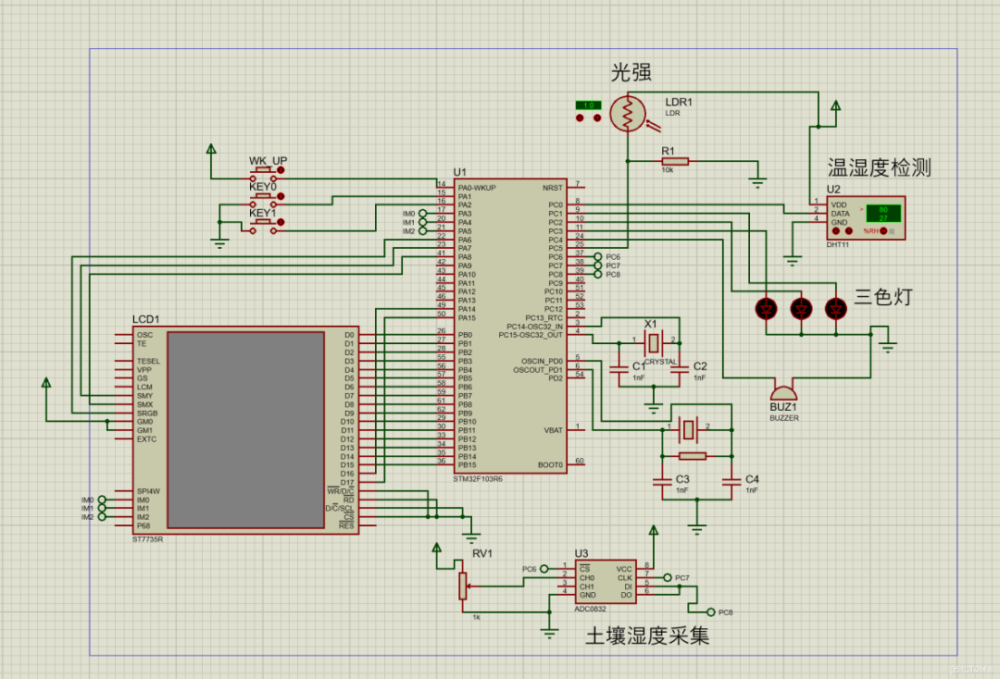
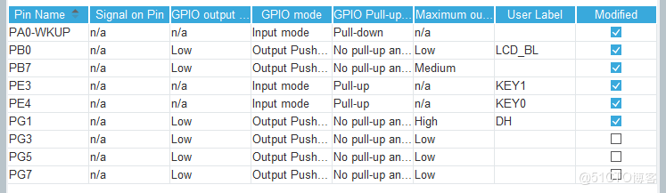
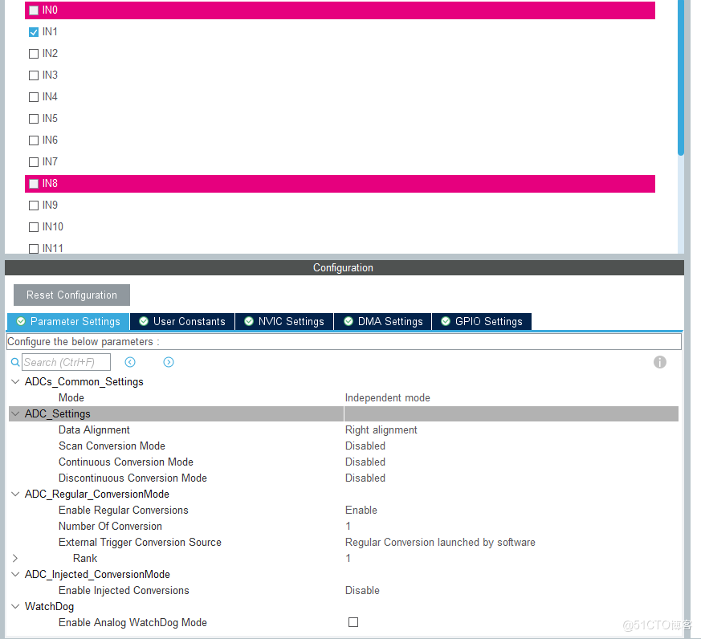
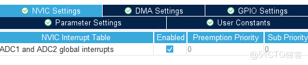
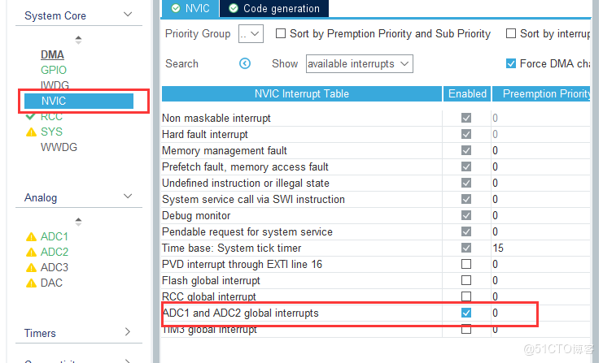
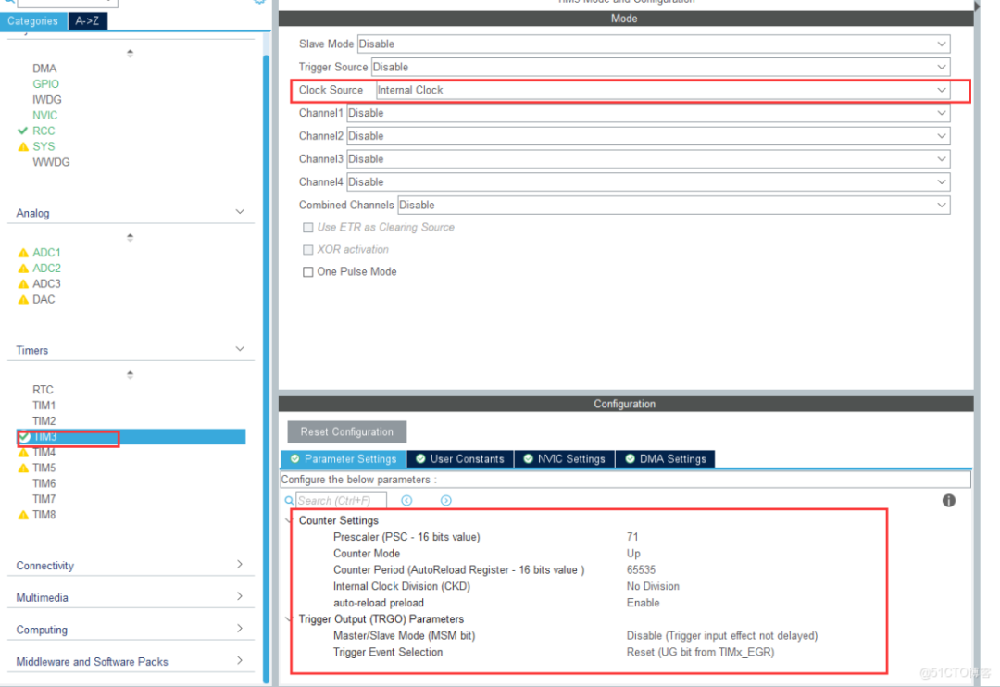
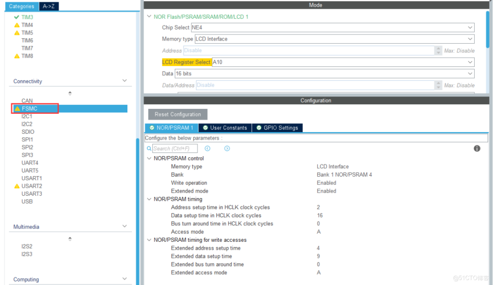
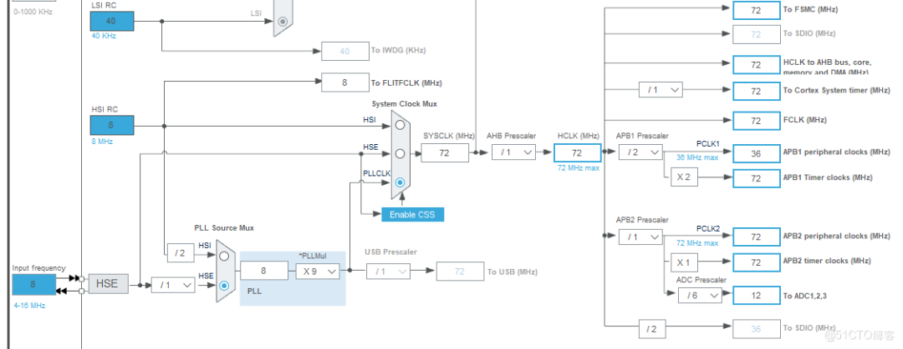
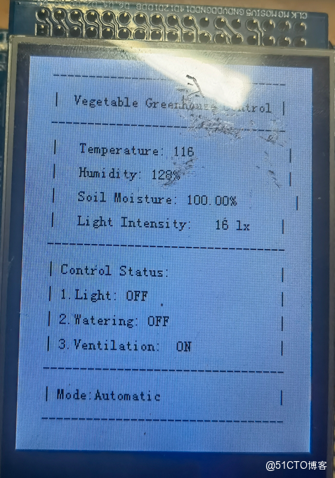
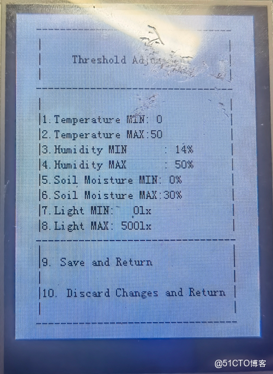

# Design Source Code + Schematic Diagram + Experiment Report + PPT Materials for the Intelligent Greenhouse Control System Based on STM32

>

Using the Positive Atom Elite Board (STM32F103ZET6)
Developed using HAL library
Pin configuration using CubeMX, code writing using Keil5
Due to the time it took me to write this README, which was more than half a year since the completion of the project, there may be errors in the content. I am very sorry for any difficulties caused by this.

### Basic Features

1.

Monitoring Function: Monitor the current status of the greenhouse, including information on air temperature, air humidity, light intensity, soil moisture, and other parameters, as well as the status of various equipment.

1.

Setting Function: This feature allows for the setting of operational parameters for various greenhouses, including soil moisture and time within the greenhouse. It automates the target values for pumps, etc., by controlling parameters such as air temperature, humidity, light, etc., to automatically control the target values for fans, extend lighting equipment, etc., and manage the on/off status of these devices.

1.

Manual control: It can achieve the forced manual control of the device's switch status in the greenhouse.

### Usage

Use the FlyMcu software to burn the `\intelligent_control\MDK-ARM\intelligent_control\intelligent_control.hex` file.

### Components used

1.

TFT-LCD, Thin Film Transistor Liquid Crystal Display - used for displaying various parameters

1.

Soil moisture detector - used to detect soil moisture

1.

Tri-colored light - used to indicate whether the backlighting device, water pump, or fan equipment is operational.

1.

Temperature/Humidity Detector--Use to detect air temperature/humidity

1.

Light intensity detection - used for detecting light intensity

1.

Buzzer - for alarm purposes

Partial Defect

-

Due to the limited number of components available for this assignment, only a three-color light was used to indicate the operational status of the illumination device, water pump, and fan, without actually using these three devices.

-

The circuit diagram is not comprehensive due to the absence of certain components.

### Circuit Diagram

!

### Configuration

#### GPIO configuration

- `PA0-WKUP`

Pin button `KEY_UP`, used for interface switching.

- `PB0`

Pins are for LCD screen backlight

- `PE4`

For the button `KEY0`, used for entering the modification view and switching options.

- `PE3`

For the button `KEY1`, used to change modes under the view of viewing and change states and threshold size under the view of modifying.

- `PB7`

Pins used to control buzzer alarm.

- `PG1`

Connect the pin to the `data` pin of the `DHT11` temperature and humidity sensor.

- `PG3, 5, 7`

Connect the pins to the three pins of the three-color light, used to reflect the current handling of the corresponding alarm.

#### ADC configuration

##### ADC1

ADC1 uses the following configuration, with pin `PA1`

Enable ADC interrupt

#### Timer

#### LCD screen

Clock tree

### Detailed Function Introduction

>

Since the time of writing this article is quite a long way from the completion of the project, I did not connect the sensors during the demonstration, so the data shown in the following figure is incorrect.

#### Main Interface

1.

Sensor data

-

Temperature: Temperature

-

Humidity:

-

Soil Moisture: Soil moisture

-

Light Intensity: Light intensity

1.

Device control

-

Light: Fill light device

-

Watering: Pump

-

Ventialtion: fan

1.

Mode selection (Mode): Switchable by pressing `KEY1` on the main interface.

-

Automatic: Automatic mode

-

When sensor data exceeds the threshold, the buzzer will be triggered for alarm processing, and the above device will also perform corresponding handling based on the type of error.

-

Manual: Manual mode

-

The three devices can be manually switched on and off, and the alarm system can be shut down.

##### Threshold Modification Interface

The switch can be activated by pressing `KEY_UP` on the main interface.

1.

Use

-

Press `KEY0` to enter the modification view, where you can see a blinking yellow square at the numbered spot. Press it again to switch options.

-

Under the modified view, pressing `KEY1` can modify the corresponding threshold, and long press to continuously increase the size of the threshold.

1.

Content meaning

-

Temperature MIN/MAX: The minimum and maximum temperature thresholds, with the upper limit of the maximum threshold being 60, exceeding which will reset at the MIN value.

-

Humidity MIN/MAX: Humidity

-

Soil Moisture MIN/MAX: Soil moisture

-

Light MIN/MAX: Light intensity

-

Option 9: Save and exit the modified view

-

Option 10: Do not save and exit.

## Payment

Here is a pay link on Stripe ( https://buy.stripe.com/3cs8yP7sY87d0vu9AB ). Please contact me lonlonago@foxmail.com after funding $89, and I will send you a complete data files , thank you!

